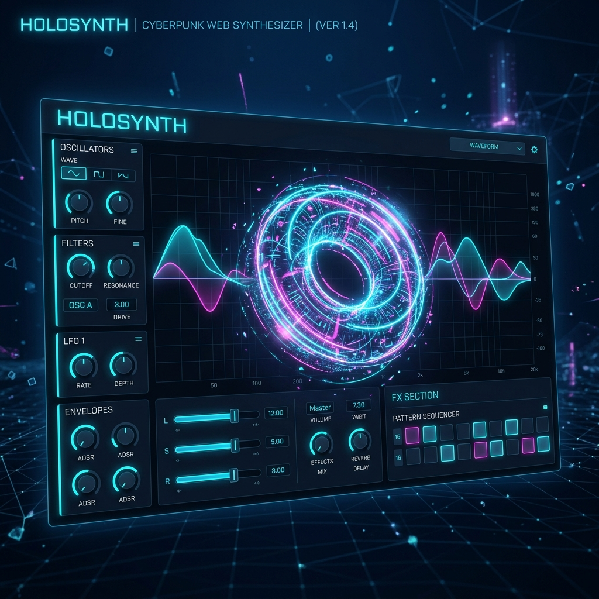
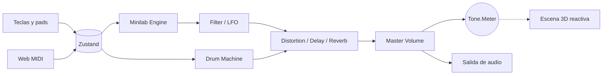

<div align="center">



# 🌌 HoloSynth Pro

**Síntesis de audio, controles virtuales y una escena 3D reactiva en el navegador.**

[](https://www.typescriptlang.org/)
[](https://reactjs.org/)
[](https://threejs.org/)
[](https://tonejs.github.io/)
[](https://github.com/pmndrs/zustand)

[Inicio rápido](#inicio-rápido) · [Controles](#controles) · [MIDI](#midi-experimental) · [Arquitectura](#arquitectura)

</div>

> **Estado: prototipo experimental.** El audio, MIDI y el rendimiento dependen del navegador y los dispositivos. No es una estación de producción profesional ni está afiliado a fabricantes de hardware.

## Inicio rápido

Necesitas Git, Node.js y pnpm, además de un navegador con WebGL 2.0 y Web Audio API. Para una base compatible con Vite y ESLint del lockfile, utiliza **Node.js 22.13 o posterior dentro de la rama 22**. El repositorio incluye `pnpm-lock.yaml`.

```bash
git clone https://github.com/geoidegeoidal/HoloSynth.git
cd HoloSynth
pnpm install --frozen-lockfile
pnpm dev
```

Abre la dirección local que muestra Vite. Interactúa con la página para habilitar el audio y empieza con las teclas del piano virtual; no necesitas un controlador MIDI para explorar la interfaz.

| Comando | Propósito |
|---|---|
| `pnpm dev` | Servidor de desarrollo. |
| `pnpm build` | Comprobación TypeScript y compilación de producción. |
| `pnpm preview` | Previsualización local del resultado de `pnpm build`. |
| `pnpm lint` | Análisis estático con ESLint. |

## Qué puedes explorar

- **Motor PolySynth:** síntesis polifónica con osciladores *fatsawtooth*, filtro, LFO, distorsión, delay y reverb.
- **Controles virtuales:** faders ADSR, knobs, pitch bend y modulación.
- **Percusión sintetizada:** ocho pads con sonidos de batería, sin samples externos.
- **Escena reactiva:** un toroide, partículas y efectos visuales vinculados al audio.
- **Estado compartido:** Zustand conecta la interfaz con los motores de sonido.

## Controles

El piano virtual se puede tocar con el ratón. Para una primera prueba con el teclado del ordenador:

| Entrada | Acción |
|---|---|
| `Z X C V B N M` | Primeras siete teclas blancas del piano. |
| `←` o `↓` | Bajar una octava. |
| `→` o `↑` | Subir una octava. |
| `0` | Restablecer la octava. |

El mapeo completo está en [VirtualPiano.tsx](src/components/minilab/VirtualPiano.tsx). Los controles y la compatibilidad siguen en validación.

## MIDI experimental

El proyecto **ya incluye** un [controlador Web MIDI](src/hooks/useMidiController.ts), activado desde [App.tsx](src/App.tsx); no es únicamente una función prevista. El hook procesa notas, pitch bend y mensajes CC para knobs, faders y modulación.

El acceso requiere que el navegador exponga Web MIDI y permita utilizar el dispositivo. Si la API no está disponible o se deniega el permiso, no se conectará el controlador. Los mensajes CC están definidos en el hook: no se garantiza que coincidan con la configuración de todos los teclados físicos.

## Arquitectura



| Módulo | Tecnología | Propósito |
|---|---|---|
| Audio | Tone.js | Síntesis, efectos y percusión. |
| Escena 3D | React Three Fiber + postprocessing | Renderizado y efectos visuales. |
| Estado | Zustand | Conectar controles, notas y parámetros de audio. |
| Interacción física | Web MIDI API | Entrada MIDI experimental según navegador y permisos. |

El [plan de implementación](docs/implementation_plan.md) conserva el contexto de diseño; describe también objetivos y no sustituye la verificación de las funciones actuales.

---

<div align="center">
  <p>Construido por <b>DeepSeek V4 Pro</b> &amp; <b>Gemini 3.1 Pro</b> con amor por el sonido sintético.</p>
</div>
